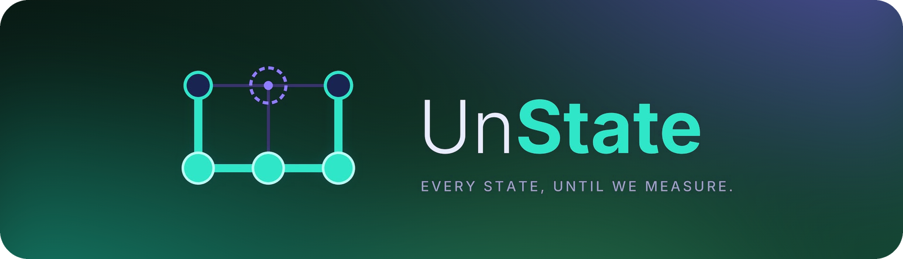

  

<h1 align="center">⚡ Eyes on the Grid</h1>

  Watch every power line with the fewest sensors, using a quantum algorithm. 
  <b>Team 1 · Challenge 3 · KACST Qiskit Fall Fest 2026</b>

  <a href="https://bandarai.github.io/kacst-qiskit-fall-fest-2026/">🖥️ Product</a> ·
  <a href="https://eyes-on-the-grid-kacst.ovalibex32.chatgpt.site/">🎮 Game</a> ·
  <a href="https://bandarai.github.io/kacst-qiskit-fall-fest-2026/product/team.html">👥 Team</a> ·
  <a href="challenge/03_move_grid_sensors_qaoa.ipynb">📓 Notebook</a>

## 👀 The problem

A sensor on a substation watches every power line connected to it. Sensors cost money, so we want the **fewest sensors that still watch every line**. Mathematicians call this *minimum vertex cover*.

On our 6-station grid with 7 lines, 2 sensors leave 2 lines unwatched. **3 sensors watch all 7.**

## 🤯 Why it is hard

Every new station doubles the choices:

| Stations | Possible placements |
|---|---|
| 6 | 64 |
| 12 | 4,096 |
| 24 | 16.8 million |
| 1,315 (Saudi transmission substations) [1] | a number with 396 digits |

Smart classical methods do not check them all. The open question is where they stop scaling.

## 🌀 How QAOA works

| Step | Gates | What happens |
|---|---|---|
| 🎲 Start | H | All 64 placements are equally likely |
| 🌀 Twist | RZ · RZZ | Turn each placement by its cost: sensors + 2 × unwatched lines |
| 🌊 Mix | RX | Good placements add up, bad ones cancel |
| 📏 Measure | M | Read one placement |

Twist and Mix repeat for *p* layers, while an ordinary computer tunes the angles 🔁

## 📈 Our results

| QAOA layers | Chance of a best placement | Two-qubit gates |
|---|---|---|
| 🎲 Random guess | 3% | – |
| 1 | 11% | 14 |
| 2 | 28% | 28 |
| 3 | **51%** | 42 |

## ⚖️ How real is it?

**Classical wins today.** On this small grid, brute force finds the best answer instantly, every time. Our 51% comes from an exact simulation with no noise, and real quantum computers are still noisy. As of November 2026, nobody has shown quantum beating the best classical method on this problem. [2]

## 📚 References

1. Saudi Energy Company, [2025 Financial Results](https://www.se.com.sa/-/media/sec/Investors/Financial-Results/FY2025-Results-Presentation.ashx), March 2026
2. QTAC Institute, [Quantum Computing Challenge](https://github.com/QTACInstitute/Quantum-Computing-Challenge), November 2026: the original notebook and its helper code

## 🙌 Credits

| | Name | Role |
|---|---|---|
| 🛠️ | [Abdulaziz Almutairi](https://www.linkedin.com/in/abdulaziz-mohammed-5a510322a) | Engineer |
| 🛠️ | [Ahmed Baljoon](https://www.linkedin.com/in/ahmed-s-baljoon-7585b8420) | Engineer |
| 💻 | [Alanoud Alshenaifi](https://www.linkedin.com/in/alanoud-alshenaifi-425794247) | Developer |
| 🛠️ | [Bandar Moshaya](https://www.linkedin.com/in/bandarmosh) | Engineer |
| ⚛️ | [Zainah Alqahtani](https://www.linkedin.com/in/zainah-ali-73419b184) | Physicist |

Made by <b>UnState</b> ⚡ 👀 ⚛️

